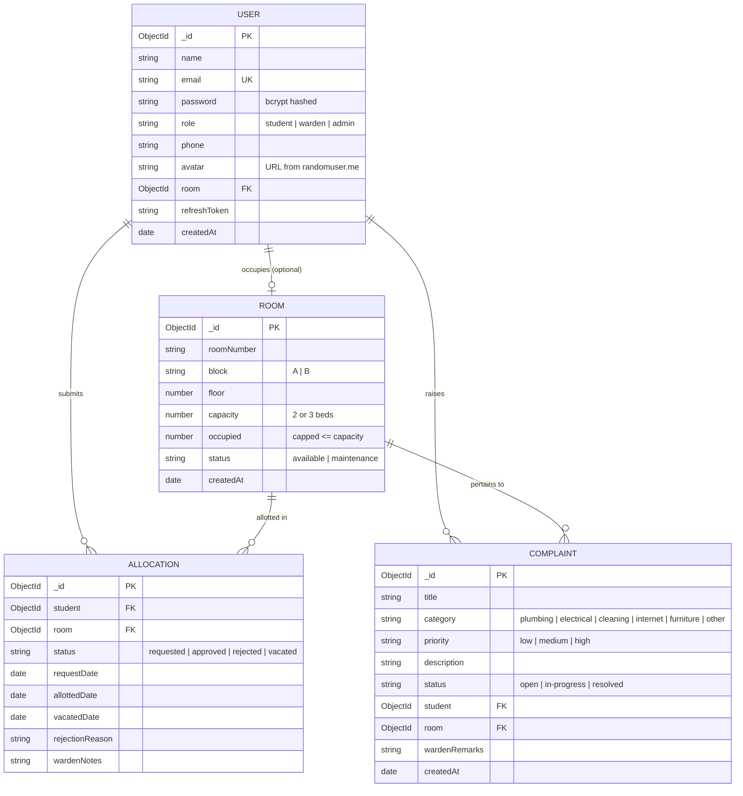

# 🏠 HostelEase — Hostel Room Allocation and Complaints System

> **Capstone Project #13** | **KR Mangalam University (KRMU)**  
> **Student:** Shraddha Sharma | **Semester:** Capstone Submission 2026  
> 🌐 **Live Website URL:** [https://hostelease-1-7pls.onrender.com](https://hostelease-1-7pls.onrender.com)  
> 🐙 **GitHub Repository:** [https://github.com/sharmashraddha00788-dot/HostelEase](https://github.com/sharmashraddha00788-dot/HostelEase)  

HostelEase is an end-to-end, production-ready MERN application designed for university residences. It automates hostel room allocations, ensures race-condition-free atomic bed booking, tracks real-time maintenance complaints, and provides wardens with live spatial room maps and MongoDB aggregation analytics.

---

## 🎯 Key Features & Capabilities

### 👨‍🎓 For Students
- **Self Registration & Login:** Public registrations are strictly assigned the `student` role.
- **Browse Available Rooms:** Real-time visibility of rooms that have free capacity and are not under maintenance. Filter by Block (A or B).
- **Atomic Room Booking:** Submit a request for a room. Enforces that a student can only have **one active request or room at a time**.
- **Live Status Tracking:** View application state (`requested`, `approved`, `rejected`), room assignment details, and instant option to **vacate room**.
- **Maintenance Complaint Ticketing:** Raise tickets with Category (*plumbing, electrical, cleaning, internet, furniture, other*) and Priority (*low, medium, high*). Track live progress and read warden inspection remarks.

### 🛡️ For Wardens & Administrators
- **Warden Analytics Dashboard:**
  - **Live Spatial Room Map:** Colour-coded visual matrix (*Full: Red, Has Students: Amber, Empty: Green, Maintenance: Gray*).
  - **MongoDB Aggregation Pipelines:** Real-time block-wise occupancy bars and complaint status/category breakdowns.
  - **KPI Metrics:** Vacant room count, pending applications, active complaints, and total student counts.
- **Atomic Room Request Approval:** Concurrently safe approval using MongoDB's atomic `findOneAndUpdate` with capacity evaluation in a single operation.
- **Hostel & Room Management:** Add rooms, configure capacities (2 or 3 beds), and toggle maintenance state.
- **Complaint Management:** Inspect student tickets, assign technicians, update status (`open`, `in-progress`, `resolved`), and record official remarks.
- **Admin Exclusive:** Comprehensive user directory search and dynamic role reassignment (`student` ↔ `warden` ↔ `admin`), plus safe room deletion (only allowed when 0 students occupy the room).

---

## 📊 Database Design & Entity Relationship (ER) Diagram

The system enforces strict relationship integrity and indexing rules across 4 main MongoDB collections:



### 🧠 Viva Highlights: Database Engineering
1. **Unique Room Compound Index:** `{ block: 1, roomNumber: 1 }` guarantees no duplicate room numbers within the same block.
2. **One Active Allocation Rule (Partial Unique Index):**
   ```javascript
   allocationSchema.index(
     { student: 1 },
     {
       unique: true,
       partialFilterExpression: { status: { $in: ['requested', 'approved'] } }
     }
   );
   ```
   *Viva explanation:* Standard unique indexes reject duplicate student entries even after they vacate. A **partial unique index** only enforces uniqueness when the status is `requested` or `approved`. Once vacated or rejected, the student can apply again!
3. **Complaint Compound Index:** `{ status: 1, priority: 1 }` enables fast, indexed filtering for high-priority open maintenance tickets.
4. **Atomic Concurrency Protection:**
   ```javascript
   await Room.findOneAndUpdate(
     {
       _id: allocation.room,
       status: 'available',
       $expr: { $lt: ['$occupied', '$capacity'] }
     },
     { $inc: { occupied: 1 } },
     { new: true }
   );
   ```
   Prevents race conditions where two simultaneous approvals could overfill a room.

---

## 🛠️ Technology Stack (Strictly Compliant with Syllabus)

| Layer | Technology | Purpose |
| :--- | :--- | :--- |
| **Backend Runtime** | Node.js & Express.js | MVC API Architecture & REST Endpoints |
| **Database** | MongoDB & Mongoose ODM | Relational schemas, aggregation pipelines, and partial indexes |
| **Authentication** | JWT (`jsonwebtoken`) & `bcrypt` | Dual Access (15m) + Refresh (7d) token architecture & password hashing |
| **Frontend UI** | React 18, React Router DOM v6 | Single Page Application (SPA), role guards, controlled forms |
| **State Management**| React Context API (`AuthContext`) | Global session state, user role badges, and silent token refreshing |
| **Network Client** | Native Fetch API | Transparent Authorization Bearer injection and 401 retry interceptor |
| **Styling** | Custom Vanilla CSS System | Plus Jakarta Sans font, subtle grid, indigo gradients, soft shadows |
| **Build Tool** | Vite | Rapid HMR dev server and optimized tree-shaken production bundles |

---

## 📋 Environment Variables (.env)

| Variable | Description | Example Value |
| :--- | :--- | :--- |
| `PORT` | Backend listening port | `5000` |
| `NODE_ENV` | Environment mode | `development` or `production` |
| `MONGO_URI` | MongoDB Connection URI (must end with `/hostelease`) | `mongodb://127.0.0.1:27017/hostelease` |
| `JWT_ACCESS_SECRET` | Secret key for signing 15m access tokens | *long_random_alphanumeric_string* |
| `JWT_ACCESS_EXPIRES_IN` | Access token lifespan | `15m` |
| `JWT_REFRESH_SECRET` | Secret key for signing 7d refresh tokens | *long_random_alphanumeric_string* |
| `JWT_REFRESH_EXPIRES_IN` | Refresh token lifespan | `7d` |

*(A template is provided in `.env.example`)*

---

## 🚀 Local Installation & Setup Guide

### Prerequisites
- Node.js (v18 or higher)
- Local MongoDB running on port 27017, OR a MongoDB Atlas cloud URI.

### 1. Clone & Enter Directory
```bash
cd C:\Users\Shraddha\Projects\HostelEase
```

### 2. Configure Environment File
Create a `.env` file at the project root:
```env
PORT=5000
NODE_ENV=development
MONGO_URI=mongodb://127.0.0.1:27017/hostelease
JWT_ACCESS_SECRET=hostelease_access_secret_2026_krmu
JWT_ACCESS_EXPIRES_IN=15m
JWT_REFRESH_SECRET=hostelease_refresh_secret_2026_krmu
JWT_REFRESH_EXPIRES_IN=7d
```

### 3. Install All Dependencies & Build Frontend
```bash
npm run build
```

### 4. Seed the Database
Populates 30 rooms, 56 Indian students fetched live from `randomuser.me` API, 48 approved room allocations, 4 pending requests, and 14 complaints:
```bash
npm run seed
```

### 5. Start Server
```bash
npm start
```
The application will launch on **`http://localhost:5000`**.

---

## 🔑 Demo Credentials for Viva & Evaluation

| Role | Email | Password | Pre-loaded Data |
| :--- | :--- | :--- | :--- |
| 👑 **Administrator** | `admin@hostelease.com` | `Admin@123` | Full control, User directory, Delete rooms |
| 🛡️ **Warden** | `warden@hostelease.com` | `Warden@123` | Room approval/reject, Map, Complaints |
| 🎓 **Allotted Student** | `student1@krmu.edu.in` | `Student@123` | Pre-allotted to Room A-101 |
| 🎓 **Unallotted Student** | `student53@krmu.edu.in` | `Student@123` | Has no room — ready to test booking! |

---

## 📡 REST API Reference

All protected endpoints require `Authorization: Bearer <accessToken>`.

### Authentication Endpoints
| Method | Endpoint | Access Role | Description |
| :--- | :--- | :--- | :--- |
| `POST` | `/api/auth/register` | Public | Register new student (role is strictly `student`) |
| `POST` | `/api/auth/login` | Public | Authenticate user & receive Access and Refresh tokens |
| `POST` | `/api/auth/refresh` | Public | Silent token refresh using refresh token |
| `POST` | `/api/auth/logout` | Protected | Invalidate refresh token session |
| `GET` | `/api/auth/me` | Protected | Fetch currently logged in user profile |

### Room Endpoints
| Method | Endpoint | Access Role | Description |
| :--- | :--- | :--- | :--- |
| `GET` | `/api/rooms/available` | All Authenticated | View non-maintenance rooms with free beds |
| `GET` | `/api/rooms` | Warden, Admin | List all hostel rooms with filters |
| `POST` | `/api/rooms` | Warden, Admin | Create a new room with capacity |
| `PATCH` | `/api/rooms/:id` | Warden, Admin | Toggle maintenance/available state |
| `DELETE`| `/api/rooms/:id` | Admin Only | Delete empty room (blocked if occupied > 0) |

### Allocation Endpoints
| Method | Endpoint | Access Role | Description |
| :--- | :--- | :--- | :--- |
| `POST` | `/api/allocations/request` | Student | Request room (one active request rule) |
| `GET` | `/api/allocations/my` | Student | View current room allotment or pending request |
| `POST` | `/api/allocations/vacate` | Student | Vacate room & atomically release bed |
| `GET` | `/api/allocations` | Warden, Admin | List all requests with status filters |
| `PATCH` | `/api/allocations/:id/approve` | Warden, Admin | Atomically check capacity & allot bed |
| `PATCH` | `/api/allocations/:id/reject` | Warden, Admin | Reject request with recorded reason |
| `POST` | `/api/allocations/:id/admin-vacate` | Warden, Admin | Force-vacate a student from room |

### Maintenance Complaint Endpoints
| Method | Endpoint | Access Role | Description |
| :--- | :--- | :--- | :--- |
| `POST` | `/api/complaints` | Student | File maintenance complaint |
| `GET` | `/api/complaints/my` | Student | List personal complaint tickets |
| `GET` | `/api/complaints` | Warden, Admin | List all campus complaints with filters |
| `PATCH` | `/api/complaints/:id` | Warden, Admin | Update ticket status & add remarks |

### Analytics & User Administration
| Method | Endpoint | Access Role | Description |
| :--- | :--- | :--- | :--- |
| `GET` | `/api/dashboard/stats` | Warden, Admin | MongoDB Aggregation KPIs & Room Map |
| `GET` | `/api/users` | Admin Only | List registered users with search & filters |
| `PATCH` | `/api/users/:id/role` | Admin Only | Change user role (`student`, `warden`, `admin`) |

---

## 🧪 Postman Collection

A complete Postman v2.1 collection is located under `/postman/HostelEase.postman_collection.json`.
- Includes environment variable `{{baseUrl}}`.
- Includes **automatic test scripts** on login requests to capture and set `{{accessToken}}` and `{{refreshToken}}`.
- Covers 100% of API endpoints with representative payload samples.

---

## 🌐 Deployment (Render)

The application is architected for **One-Service Cloud Deployment**:
1. In production, Node.js/Express statically serves `client/dist`.
2. Any non-API route returns `client/dist/index.html` (resolving client-side router 404s on refresh).
3. Build command:
   ```bash
   npm run build
   ```
4. Start command:
   ```bash
   npm start
   ```
